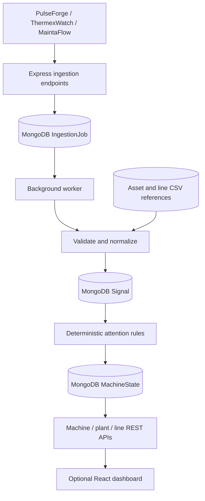

# Aurik — Industrial Equipment Monitoring

Backend-first Tech Lead take-home assessment for **Aurik Technologies**. The service receives machine events and maintenance observations from multiple vendors, normalizes them, processes jobs asynchronously, calculates explainable machine attention states, and exposes backend-facing REST APIs. An optional lightweight React dashboard demonstrates the output. All fixture data is synthetic.

## Stack

- **Backend:** Node.js (ES modules), Express, MongoDB and Mongoose.
- **Validation:** Plain JavaScript (no Zod).
- **Background processing:** MongoDB-backed job polling (no Redis or external queue).
- **Frontend (optional):** React + Vite, native `fetch`, plain CSS.
- **Tests:** Node.js built-in test runner (no Jest or Supertest).

Node.js is the selected implementation stack, although the assignment brief prefers Go, Python or C#.

## Features

- **Vendor ingestion:** Accept separate JSON formats from PulseForge, ThermexWatch and MaintaFlow. Validate batch envelopes and report malformed records without discarding valid siblings.
- **Normalization:** Resolve machines/plants/lines from reference CSVs, map event types/severity, standardize timestamps, convert Fahrenheit to Celsius, and keep vendor IDs plus original payloads for traceability.
- **Async jobs:** Store accepted batches in MongoDB and return HTTP `202`. Poll pending jobs in the background, record progress, and retry processing failures.
- **Duplicate/out-of-order handling:** Unique vendor IDs and content fingerprints prevent duplicate signal insertion. Recompute operational state by event timestamps rather than message arrival order.
- **Derived attention:** Calculate a deterministic machine-level status, attention level, reason codes, latest signals, source references and freshness. Aggregate line- and plant-level summaries.
- **Conflicting reports:** Recovery from one sensor vendor does not erase an independent vendor's critical alert or an unresolved maintenance inspection finding.

## Architecture



The backend uses **MVC + a small service layer**: controllers handle HTTP, models persist records, services implement normalization and attention rules, and the worker processes jobs. The server entry point is `server/server.js`; there is no separate `app.js`.

## Repository structure

```text
Aurik_Tech_Lead_Assessment_Assets/    Original assessment fixtures and CSVs
server/
  server.js                          Express server entry point
  config/                            MongoDB connection
  routes/                            API routes
  controllers/                       Request handlers
  models/                            Mongoose schemas
  services/                          Normalization and attention rules
  workers/                           Background job processing
  middleware/                        API error handling
  utils/                             Validation and CSV parsing
  scripts/                           Asset seed and sample import
  tests/                             Dependency-free unit tests
  docs/DESIGN_NOTE.md                Short design note
client/                               Optional React + Vite dashboard
```

## Local setup

**Requirements:** Node.js 20+ (22 recommended), npm, MongoDB running locally. Docker Compose is not needed.

From the repository root:

```bash
cd server
npm install
cp .env.example .env
npm run seed
npm run demo
npm start
```

- Expected backend URL: `http://localhost:5000`
- Default database URI: `mongodb://127.0.0.1:27017/aurik_monitoring`
- Health endpoint: `GET http://localhost:5000/health`

To run the optional frontend in a second terminal:

```bash
cd client
npm install
npm run dev
```

Open `http://localhost:5173`. Vite proxies `/api` and `/health` to the local backend.

**Important — verify before submission:** At the time of the `master` review (October 15, 2026), `server/server.js` called `cors()` without importing it and did not start the worker. Also, `server/scripts/seed.js` imports `models/Asset.js` and `models/Line.js`, while the committed model filenames are `asset.model.js` and `line.model.js`. These are known startup blockers. Fix and verify a complete local run before submitting. This repository-cleanup patch deliberately leaves your existing backend code untouched.

## REST API contract

All APIs use JSON.

| Method | Endpoint | Purpose |
| --- | --- | --- |
| GET | `/health` | Server health |
| POST | `/api/ingest/pulseforge` | Receive PulseForge `events` batch |
| POST | `/api/ingest/thermexwatch` | Receive ThermexWatch `readings` batch |
| POST | `/api/ingest/maintaflow` | Receive MaintaFlow `records` batch |
| GET | `/api/jobs/:jobId` | Processing status, counts, and issues |
| GET | `/api/machines/:machineId/status` | Derived machine attention view |
| GET | `/api/plants/:plantId/summary` | Plant-level machine status counts |
| GET | `/api/plants/:plantId/lines/:lineId/summary` | Line-level status counts |

### Sample ingestion

```bash
curl -X POST http://localhost:5000/api/ingest/pulseforge \
  -H 'Content-Type: application/json' \
  -d '{
    "vendor": "PulseForge",
    "plant_id": "PLANT_01",
    "events": [{
      "event_id": "PF-1001",
      "machine_id": "EQ-001",
      "line_id": "LINE-A",
      "event_time": "2026-04-18T07:59:12Z",
      "event_type": "HIGH_VIBRATION",
      "severity": "high",
      "vibration_mm_s": 11.8,
      "temperature_c": 83.2,
      "machine_state": "running",
      "sensor_health": 0.91,
      "vendor_confidence": 0.87
    }]
  }'
```

A valid batch is accepted with HTTP `202`, a `job_id`, record count, and status URL. Poll `GET /api/jobs/:jobId` for `completed`, `partial` or `failed`; valid siblings can succeed even if another record is malformed. The machine endpoint returns machine/plant/line IDs, operational status, whether attention is required, severity, reason codes, processing status/freshness and source event references.

### Sample read requests

```bash
curl http://localhost:5000/api/machines/EQ-008/status
curl http://localhost:5000/api/plants/PLANT_02/summary
curl http://localhost:5000/api/plants/PLANT_02/lines/LINE-E/summary
```

## Testing and manual review

The assessment specifically requires **meaningful tests**, so the repository keeps its existing lightweight Node.js unit test, with no testing-framework dependency:

```bash
cd server
npm test
```

The original asset folder contains `vendor_api_samples/happy_path.json`, `duplicates.json`, `malformed.json`, `out_of_order.json`, `conflicting_updates.json` and `retry_cases.json`. Submit each vendor-specific child of a mixed-vendor JSON fixture to the matching endpoint to exercise those scenarios. The local seed/demo commands use the provided reference and event CSVs. April 2026 fixture data may appear stale at runtime; data freshness does not automatically mean that a machine's safety issue has been resolved.

## Assumptions and trade-offs

- **Vendor schema:** Version `v1` is supported. Vendor event IDs are treated as immutable; changed data with an existing ID is a conflict rather than an implicit correction.
- **Units:** Fahrenheit converts to Celsius; vibration acceleration (`g`) is not directly converted to vibration velocity (`mm/s`).
- **Time zones:** MaintaFlow timestamps without a zone are interpreted as UTC.
- **Operational decisions:** Recovery is source-scoped. Independent critical temperature or inspection findings remain actionable.
- **Simplicity:** A MongoDB polling worker avoids extra services for a small assessment, but lacks production-grade lease renewal and distributed worker coordination.
- **Limitations:** No tenant authorization, rate limits, structured monitoring, deployment pipeline, or production correction/versioning flow.

See [`server/docs/DESIGN_NOTE.md`](server/docs/DESIGN_NOTE.md) for additional implementation decisions and production trade-offs.

## What I would do next for production

Add automated end-to-end verification with MongoDB, secure vendor authentication, API rate limits, structured logs and metrics, worker heartbeat/lease renewal, dead-letter redrive, safe concurrent machine-state updates, migration/versioning support, and deployment automation. A dedicated queue could be added only if load requires it.

## AI usage disclosure

**OpenAI ChatGPT** was used to assist with backend/frontend code drafts, code review, and documentation. The candidate chose Node.js/Express/Mongoose and requested a simple MVC structure with plain JavaScript validation and minimal infrastructure. The candidate remains responsible for independently reviewing, running, explaining, and defending the submission.
